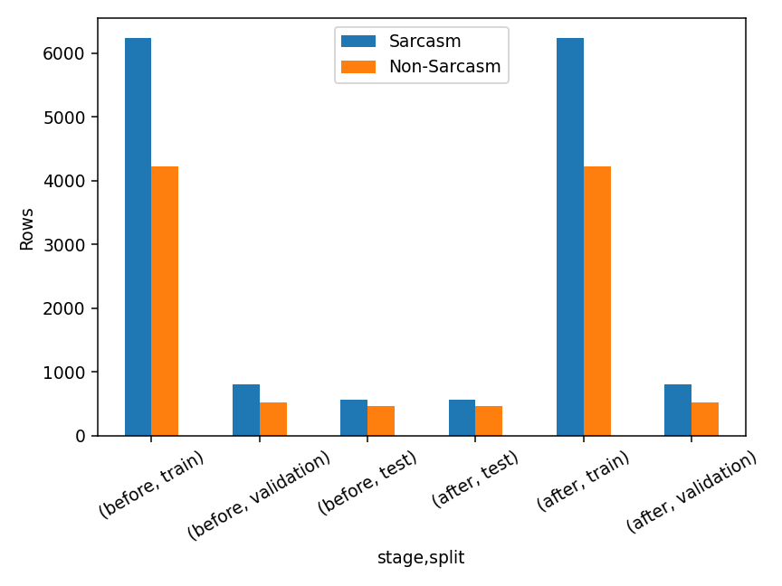
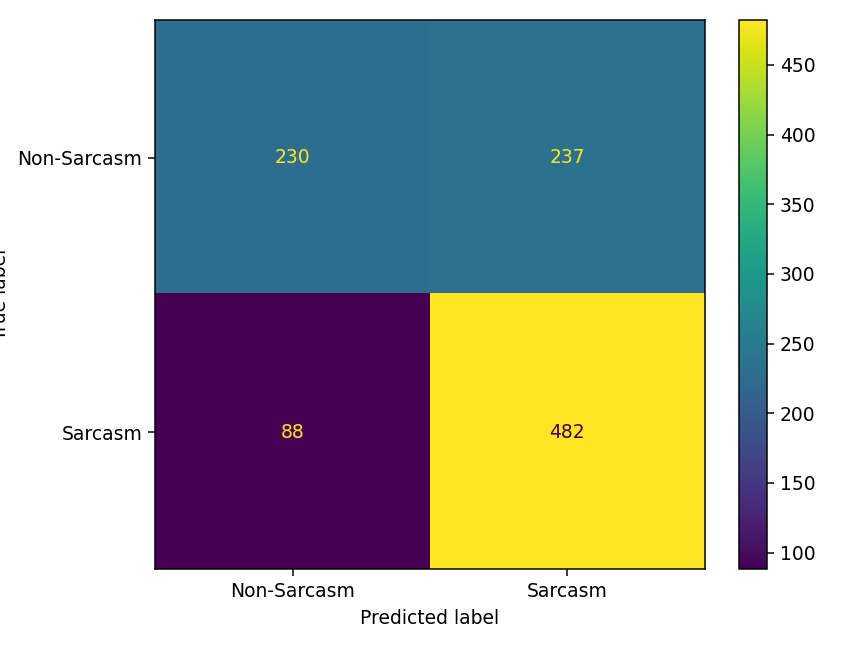
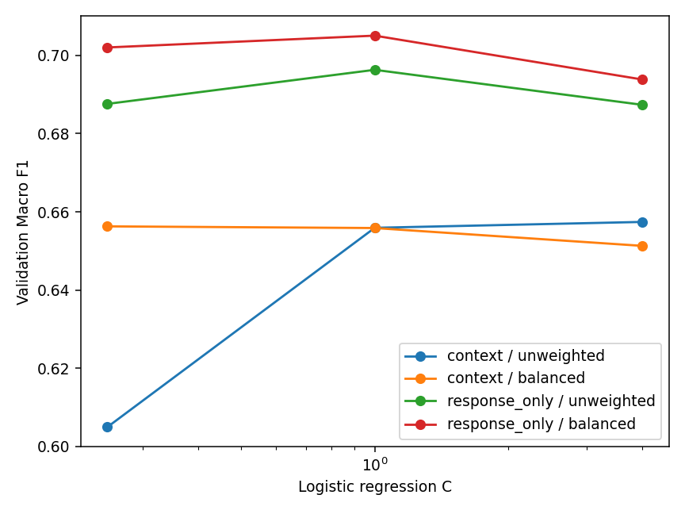
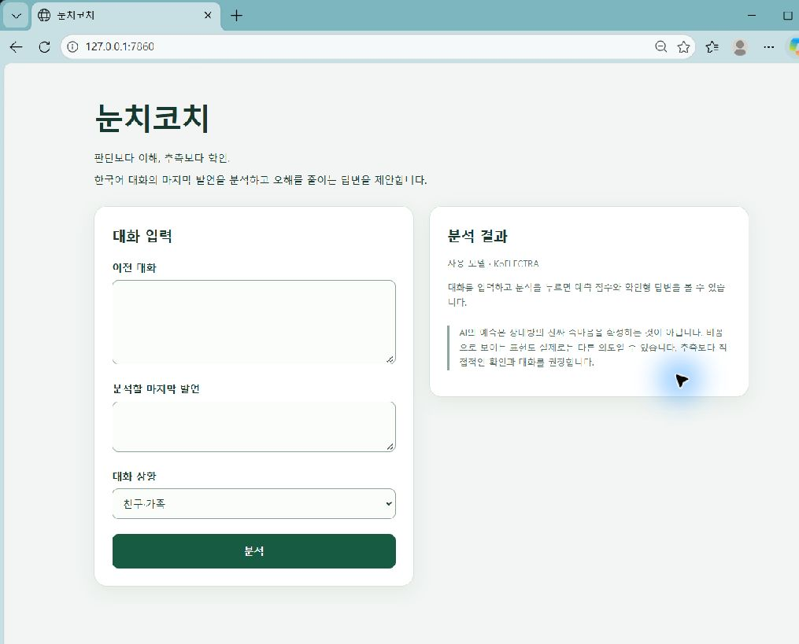
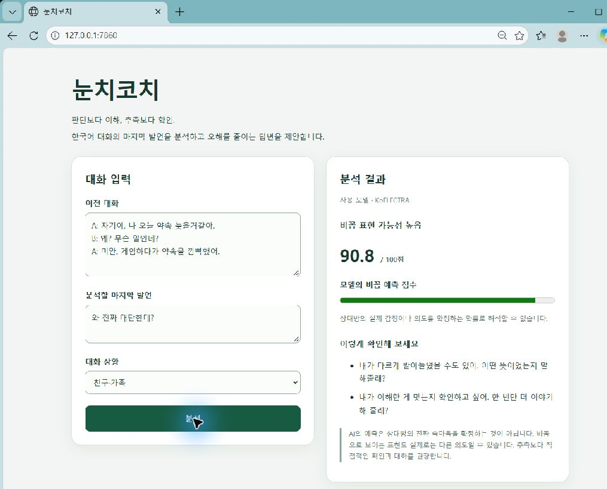
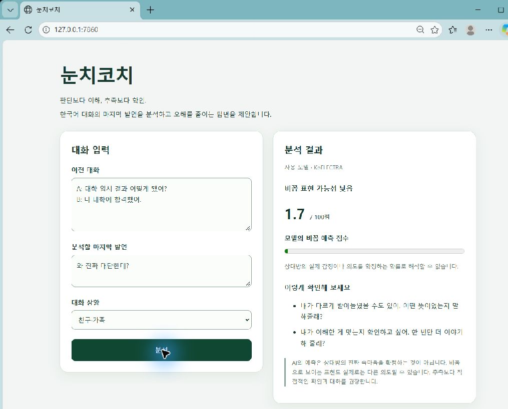
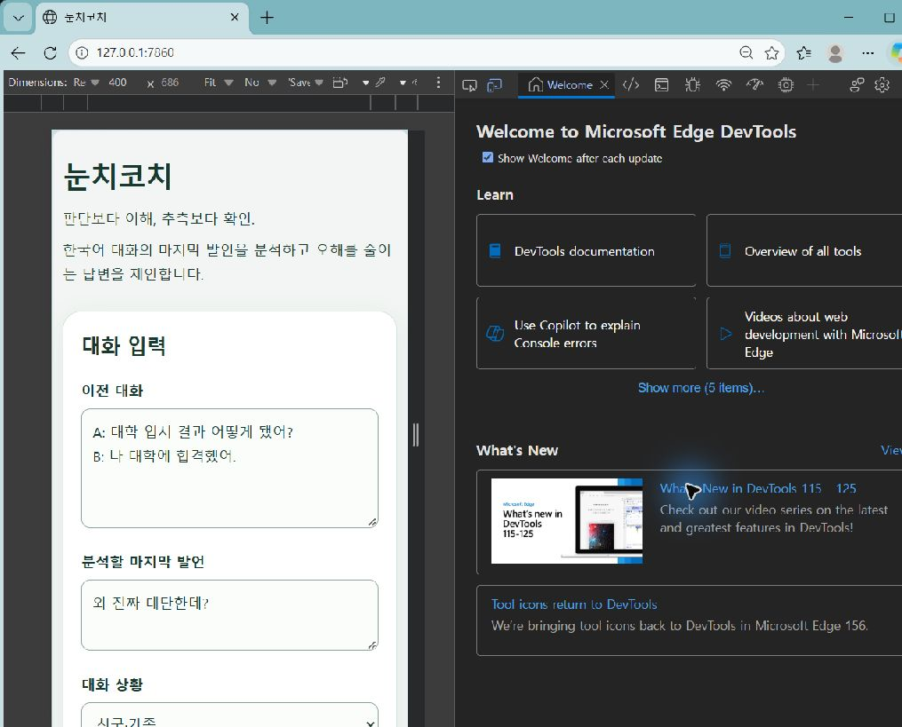
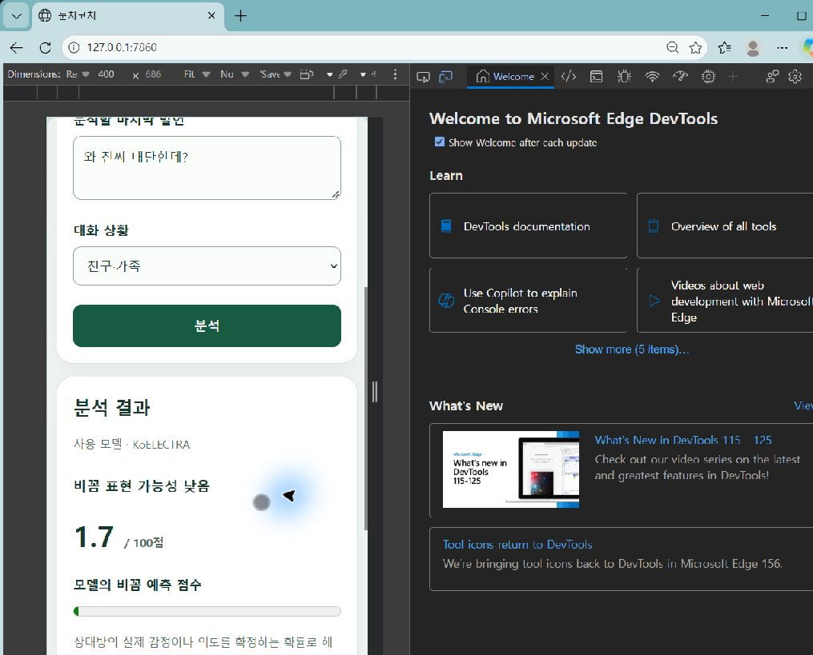

# 눈치코치 — 비꼼 판별 및 대화 대응 도우미

판단보다 이해, 추측보다 확인.

## 0. 프로젝트 정보

학번 202439751 · 이름 이현지. 제출 안내의 필수 프로젝트 식별 정보로 기재한다.

한국어 대화의 비꼼 표현 가능성을 분류하고 확인형 답변을 제안하는 개인 머신러닝 프로젝트다. 사용자가 Google Colab 학습·평가와 Flask KoELECTRA 추론 완료를 보고했다. 이번 점검에서 실제 평가 CSV와 가중치·토크나이저를 확인했다. 전용 Python 환경을 복구하고 실제 ElectraForSequenceClassification 로딩과 Flask 추론을 검증했다. [GitHub 공개 코드](https://github.com/nanlhj2004-cell/NoonchiCoach) · [임시 공개 데모](https://ran-lenses-success-painting.trycloudflare.com). 데모는 로컬 컴퓨터와 Flask 및 Cloudflare 터널이 실행 중인 동안 동작한다. 재시작 시 URL이 변경되므로 영구 호스팅은 별도로 확보해야 한다.

## 1. 문제 정의

- Who — 메신저 말투 해석과 답변이 어려운 친구·가족·동료.
- What — 앞선 대화와 마지막 발언에서 비꼼의 언어적 특징을 분석한다.
- When — 뉘앙스가 모호하거나 오해를 줄이는 답변이 필요할 때.
- Why — 성급한 의도 추측에서 비롯되는 갈등을 줄이기 위해서다.

차별점은 맥락을 입력받고 직접 확인하는 답변을 제안하는 것이다. 정량 목표는 KoCoSa Test Macro F1 0.75 이상이며 실제 Colab KoELECTRA 결과 0.7368로 미달했다. 비꼼 아님을 잘못 의심하는 FPR도 중요한 평가 요소다.

## 2. 데이터

[KoCoSa](https://huggingface.co/datasets/YuminKim/KoCoSa)는 한국어 대화 맥락과 마지막 발언을 제공해 주 학습 데이터로 선정했다. [논문](https://aclanthology.org/2024.lrec-main.864/)을 참고했다. 원본 Parquet는 총 3,484,652바이트다.

| 분할 | 전체 | Sarcasm | Non-Sarcasm |
|---|---:|---:|---:|
| Train | 10,466 | 6,237 | 4,229 |
| Validation | 1,321 | 801 | 520 |
| Test | 1,037 | 570 | 467 |

[Kocasm](https://huggingface.co/datasets/SpellOnYou/kor_sarcasm)은 단일 소셜 문장 데이터로 Train 9,000건과 Test 301건이다. Train은 품질 검사, Test는 외부 평가에 사용한다. 0=no_sarcasm, 1=sarcasm을 KoCoSa의 Non-Sarcasm=0, Sarcasm=1과 맞춘다. 수집·주석·입력 환경은 두 데이터셋 사이에 차이가 있다.

KoCoSa 재배포 및 파인튜닝 가중치 공개 조건은 미확인이다. Kocasm 데이터 카드는 MIT, KoELECTRA 모델 카드는 Apache-2.0으로 표시한다. 공개 전 적용 조건을 확인한다.

## 3. 데이터 전처리

필수값 검증, NFC·공백 정규화, 중복·충돌 처리, 맥락과 마지막 발언의 입력 형식 통일을 구현했다. 문장부호와 말투를 보존하고 sarcasm_explanation은 학습 입력에서 제외한다. 기존 감사에서 필수 결측·정규화 입력 중복·레이블 충돌·분할 간 동일 입력은 모두 0건이다. 전후 클래스 분포와 건수는 위 표와 동일하다. 의미 기반 재서술 누수는 미검사다. 공식 분할을 유지하고 실험 seed는 42다.

설명이 빈 5,216건은 모두 Non-Sarcasm이므로 필수값 결측으로 제거하지 않았다. 저장된 token_lengths.json에서 Train 토큰 길이 중앙값 94, 95백분위 145, 최대 250을 확인했다. 최대 입력 길이는 152이고 잘린 입력은 Train 379건, Validation 35건, Test 42건이다.



## 4. 모델

A는 문자 2–5그램 TF-IDF와 Logistic Regression이다. 한국어 표현 패턴을 가볍게 학습하고 CPU에서 추론하기 위해 선정했다. Train으로 학습하고 Validation으로 C와 클래스 가중치를 선택한다. 마지막 발언형은 보조 실험이다.

B는 monologg/koelectra-base-v3-discriminator의 이진 분류 파인튜닝이다. 발언과 맥락의 관계를 학습하기 위해 선정했다. 사용자가 Colab 학습·평가를 완료했으며 저장된 모델의 architectures는 ElectraForSequenceClassification, 레이블은 Non-Sarcasm=0과 Sarcasm=1, Transformers 버전은 4.51.3이다.

코드 설정은 학습률 2e-5, 3 epoch, 유효 배치 16, seed 42, FP16이며 Validation Macro F1으로 최적 체크포인트를 선택한다. 해당 실행의 전체 학습 로그는 현재 로컬에서 찾지 못해 실제 적용 인자와 Loss 곡선의 원본 대조는 남아 있다.

## 5. 평가 결과

다운로드된 실제 model_comparison.csv를 대조하고 [평가 CSV 사본](docs/model_comparison_colab.csv)을 보존했다. Precision·Recall은 비꼼 양성 기준이며 FPR은 FP/(FP+TN)이다.

| 데이터 | 모델 | Accuracy | Macro F1 | Precision | Recall | FPR |
|---|---|---:|---:|---:|---:|---:|
| KoCoSa Test | TF-IDF + LR | 0.6818 | 0.6620 | 0.6671 | 0.8404 | 0.5118 |
| KoCoSa Test | KoELECTRA | 0.7551 | 0.7368 | 0.7135 | 0.9263 | 0.4540 |
| Kocasm Test | TF-IDF + LR | 0.4817 | 0.3967 | 0.5333 | 0.1013 | 0.0979 |
| Kocasm Test | KoELECTRA | 0.4884 | 0.3547 | 0.8333 | 0.0316 | 0.0070 |

동일한 KoCoSa Test에서 KoELECTRA의 Macro F1이 더 높다. 다만 비꼼 아님 중 약 45.4%를 오탐하므로 의도를 단정할 수 없다. Kocasm Recall 0.0316은 외부 비꼼 사례 대부분을 놓쳤음을 보여준다. 도메인·맥락·표현·주석 차이가 가능한 원인이며 각각의 영향을 이 결과만으로 확정할 수 없다. 외부 Test는 모델 및 임계값 선택에 사용하지 않는다.

results/metrics.json은 별도 로컬 실행으로 맥락형 Macro F1 0.6669를 기록한다. Colab의 0.6620과 구분해 보존했다. 아래 혼동행렬과 검증 그래프도 기존 로컬 베이스라인 결과다. Colab KoELECTRA 혼동행렬과 Loss 원본은 추가 확보가 필요하다. 서비스는 score > 0.50을 사용하며 임계값 분석은 별도 단계다.




### 탐색적 실사용 테스트

사용자가 동일한 이전 대화에서 마지막 발언을 바꿔 관찰한 KoELECTRA 점수다.

| 마지막 발언 | 점수 |
|---|---:|
| 와 진짜 대단한데? | 46.5 |
| 와 진짜 대단하다. | 83.6 |
| 와 진짜 대단하다? | 86.9 |
| 와 진짜 대단한데. | 29.5 |

‘와 진짜 대단한데?’를 고정한 맥락 비교에서는 대학 합격 1.7점과 불합격 46.5점이었다. 표현·문장부호·맥락에 대한 민감도를 관찰한 소수의 탐색 사례이며 정확도 향상이나 인과관계 검증으로 해석하지 않는다. 복구 환경에서 동일한 입력으로 46.5·83.6·86.9·29.5점, 합격 1.7점과 불합격 46.5점이 소수점 한 자리까지 재현됐다. 게임 때문에 약속을 잊은 대화도 90.8점으로 재현했다.

## 6. 서비스 프로토타입

Flask에서 이전 대화, 마지막 발언과 상황을 받아 저장된 모델로 추론한다. 환경 변수로 KoELECTRA와 TF-IDF를 선택하고 모델명·점수·확인형 답변을 표시한다. 로딩 실패 시 다른 모델로 자동 대체하는 코드는 없다. 카드형 반응형 UI와 입력값 유지 기능을 제공한다.

‘비꼼 표현 가능성 높음/낮음’으로 결과를 표현한다. 40~60점은 참고용 불확실 구간이며 검증된 통계적 기준이 아니다. 점수는 상대방의 실제 의도 확률로 해석할 수 없다. 모델의 판단 근거를 추출하는 기능은 구현하지 않았다.

AI의 예측은 상대방의 진짜 속마음을 확정하는 것이 아닙니다. 비꼼으로 보이는 표현도 실제로는 다른 의도일 수 있습니다. 추측보다 직접적인 확인과 대화를 권장합니다.

아래 화면은 복구한 Python 환경의 KoELECTRA를 실제 Flask 서비스로 실행하고 Edge에서 촬영했다. 400px 반응형 모드에서 입력·결과 카드가 세로로 배치됨을 확인했다.









## 7. 배포

GitHub에 코드와 최신 캡처를 공개했다. 가중치는 Hugging Face nanlhj/noonchicoach-koelectra 비공개 저장소에 보관한다. 현재 계정에서 Docker Space는 유료 플랜을 요구해 생성하지 않았다. 무료 Cloudflare Quick Tunnel의 임시 공개 URL에서 실제 KoELECTRA 90.8점 추론과 입력 검증을 확인했다. 로컬 컴퓨터 및 서버·터널의 지속 실행이 필요하다.

## 8. 실행 방법

### 제출 전 확인

제출처는 사이버캠퍼스 12차시-기말프로젝트이며 마감은 12차시 오전 9시다. 달력 날짜는 사이버캠퍼스에서 확인한다. 제출 파일명은 기말-202439751-이현지.zip이다. ZIP에는 README와 동일한 포트폴리오 PDF, 실행 출력이 유지된 코드, submission.json을 포함한다. 100MB 초과 모델·데이터는 외부 링크로 제공하고 API 키를 업로드하지 않는다. 공개 GitHub와 데모 URL은 채점 종료까지 유지한다. 현재 저장된 포트폴리오 PDF와 제출 ZIP, submission.json에는 과거 상태가 남아 있어 최종 갱신이 필요하다.

기본 의존성은 requirements.txt, Colab은 requirements-colab.txt를 사용한다. [통합 노트북](NoonchiCoach_Complete_Colab.ipynb)과 [Colab 안내](COLAB_GUIDE.md)를 참고한다. 기존 모델로 추론할 때 재학습은 필요하지 않다.

정상 Python 환경에서 의존성을 준비하고 프로젝트 폴더에서 python app.py를 실행한 뒤 http://127.0.0.1:7860/에 접속한다. 기본 TF-IDF 가중치는 results/baseline.joblib이다.

KoELECTRA는 PyTorch와 Transformers 4.51.3 환경이 필요하다. NOONCHI_MODEL을 koelectra, NOONCHI_MODEL_PATH를 기존 final 폴더 경로로 지정한다. final에는 model.safetensors, config.json, tokenizer.json, tokenizer_config.json, special_tokens_map.json, vocab.txt를 둔다. final 상위 폴더에 token_lengths.json을 함께 둔다.

가중치 451,715,672바이트와 관련 파일을 외부 작업 사본에서 확인했다. 100MB 초과 파일은 Git에 직접 넣지 않는다. 경로와 해시는 작업 점검 기록으로 관리한다. 기존 두 가상환경은 사라진 Python 3.11을 참조했다. 기존 환경을 보존하고 .venv-koelectra를 Python 3.13.9로 새로 구성했다. PyTorch 2.6.0, Transformers 4.51.3, Flask 3.1.3, Tokenizers 0.21.4에서 CPU 추론을 검증했다. 입력 최대 길이 152, 판정 score > 0.50을 유지한다.

### 복구 환경 실행

프로젝트 루트에서 PowerShell로 실행한다. 모델은 기존 저장 위치를 직접 참조하며 별도 복사하지 않는다. 환경 변수는 실행하는 셸에 적용된다.

```powershell
$env:NOONCHI_MODEL = 'koelectra'
$env:NOONCHI_MODEL_PATH = '<local-model-directory>/final'
$env:HF_HUB_OFFLINE = '1'
$env:OMP_NUM_THREADS = '4'
$env:MKL_NUM_THREADS = '4'
& ./.venv-koelectra/Scripts/python.exe app.py
```

다른 컴퓨터에서는 NOONCHI_MODEL_PATH를 그 컴퓨터의 final 폴더로 바꾼다. final 상위 token_lengths.json도 필요하다. 베이스라인은 NOONCHI_MODEL을 baseline으로 바꾸고 NOONCHI_MODEL_PATH 환경 변수를 제거해 실행한다. 환경을 다시 구성할 때는 Python 3.13 가상환경에서 requirements-koelectra.txt를 설치한다. 검증 환경은 위 Python 및 패키지 버전과 같다.

정상 입력·상황 선택·입력 유지·40~60점 안내·HTML 이스케이프가 통과했다. 빈 입력과 길이 초과는 400, 요청 크기 초과는 안내와 함께 413으로 처리됐다. KoELECTRA 모델 경로 오류는 시작 실패로 드러나며 다른 모델로 자동 대체되지 않는다. 상세 검증 기록은 비공개 작업 폴더에서 보관한다. Colab 평가 지표는 재계산하지 않았다.

## 9. Lessons Learned

**Plus**

- Colab 학습과 평가를 완료하고 실제 CSV에서 내부 Macro F1 개선을 확인했다.
- 확인형 답변과 불확실 구간 안내로 단정적인 해석을 줄이도록 UI를 설계했다. 변경 전후 베이스라인 점수 일치를 확인했다.

**Minus**

- 내부 KoELECTRA FPR 0.4540은 비꼼 아님 발언을 잘못 의심하는 문제를 보여준다.
- 외부 Recall 0.0316은 일반화의 한계다. 텍스트는 표정과 억양을 포함하지 않는다.
- 기존 인터프리터가 사라져 실행이 중단됐다. 전용 Python 3.13 환경과 패키지 기록을 준비해 기존 가중치 로딩과 서비스 추론을 복구했다.

**Interesting**

- 동일한 맥락에서 표현 변화에 따라 29.5~86.9점이 관찰됐다.
- 동일 발언이 합격 맥락 1.7점과 불합격 맥락 46.5점으로 달라졌다. 인과관계 검증은 아니다.
- 설명이 빈 5,216건이 모두 Non-Sarcasm이어서 무조건 제거하면 클래스 분포가 바뀐다.

**문제 해결**

- Colab pandas/PyArrow 충돌 → 기본 환경과 설치 버전 요구 충돌 → pandas 2.2.3, PyArrow 19 이상 24 미만으로 설치 정책 수정 → 이후 사용자가 통합 학습·평가 완료를 보고하고 CSV를 확보했다. 당시 설치 로그 원본은 미확보다.
- 의도 단정 위험 → 높은 오탐률과 실사용 점수 변동 확인 → 확인형 답변·점수 해석 안내·불확실 구간 도입 → 기존 베이스라인 점수 보존과 입력 검증이 통과했다.

**향후 개선**

- 데이터는 동의 기반 실제 대화와 표현 변형 평가셋을 추가하고 누수를 감사한다.
- 모델은 Validation에서 FPR과 Macro F1을 고려해 임계값을 선택한 후 고정해 Test를 평가한다.
- 서비스는 확인형 답변의 이해도를 평가하고 모델·환경 버전을 기록해 재현성을 높인다.
